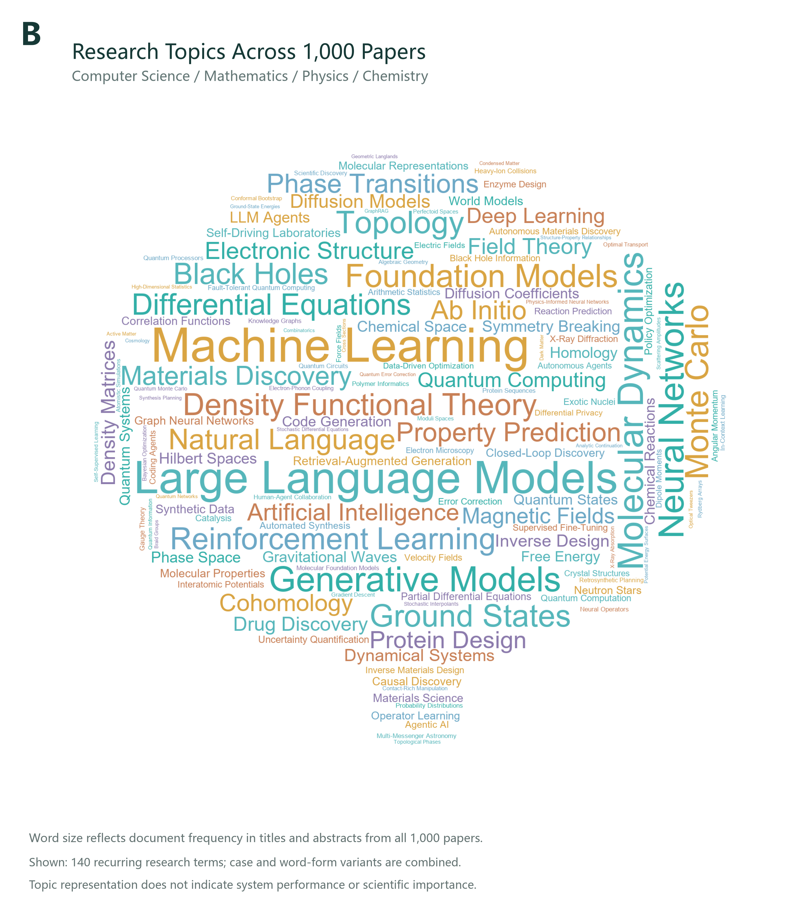
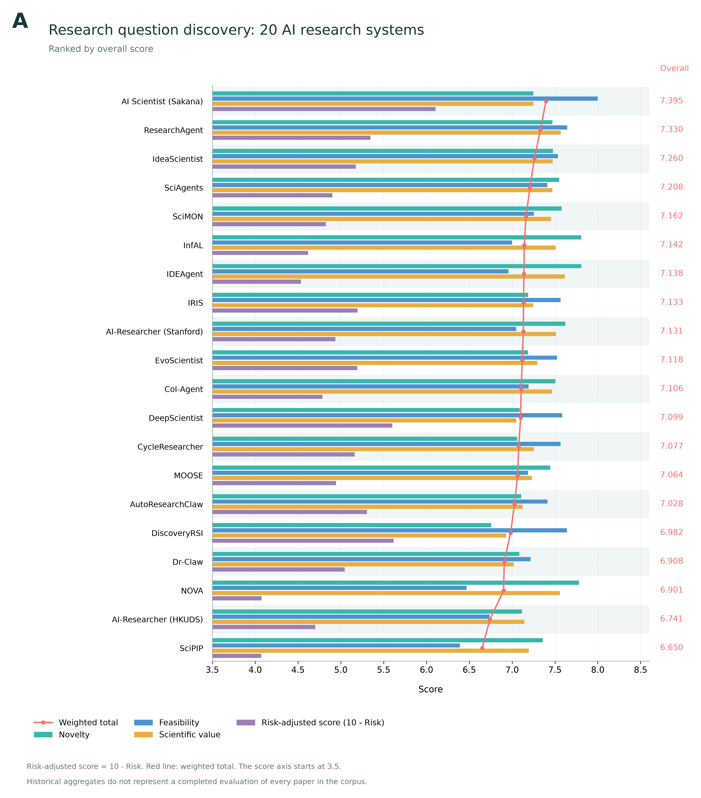

# AI Science Discovery Bench

**Evaluating scientific question discovery in AI research systems.**

[Dataset](#dataset) · [Evaluation](#evaluation-framework) · [Leaderboard](#leaderboard) · [Getting Started](#evaluation-instructions) · [System Sources](#system-sources) · [License](#license-and-notices)

Large language models are enabling research agents to analyze literature, develop ideas, and plan experiments. Understanding an existing study and discovering a valuable new research question are different capabilities. Question discovery requires substantive novelty, scientific importance, and a credible route to an answer.

**AI Science Discovery Bench** provides a cross-disciplinary corpus of **1,000 papers** spanning **computer science, mathematics, physics, and chemistry**, with **96 covered research directions**. It evaluates research questions through **four dimensions and 16 criteria**: novelty, feasibility, scientific value, and research risk. The reference comparison covers **20 AI research systems**, with their papers, affiliations, and official repositories listed below.

This release provides a versioned paper index, a runnable model-based evaluator, the full scoring rubric, and an aggregate reference leaderboard. It helps researchers compare question-discovery methods using a consistent evaluation protocol.

## Dataset

| Domain | Papers | Covered research directions |
| --- | ---: | ---: |
| Computer science | 250 | 31 |
| Mathematics | 250 | 23 |
| Physics | 250 | 26 |
| Chemistry | 250 | 16 |
| **Total** | **1,000** | **96** |

The full paper index is available in [`data/papers.jsonl`](data/papers.jsonl). Each record includes a persistent ID, pinned arXiv version, title, abstract, authors, source links, PDF size, and SHA-256. Record fields and counting conventions are documented below.

<details>
<summary>Paper record fields and dataset conventions</summary>

The corpus snapshot is dated **2026-09-17**; the release version is **0.1.0**. The index is UTF-8 JSONL with one paper per line.

| Fields | Meaning |
| --- | --- |
| `paper_id`, `domain`, `arxiv_id`, `version_id` | Unique domain/arXiv-ID key, benchmark domain, original identifier, and pinned version. |
| `title`, `abstract`, `authors` | Original scientific metadata from arXiv. |
| `published`, `updated`, `primary_category`, `categories` | Publication and version timestamps and original arXiv categories. |
| `doi`, `journal_ref`, `abs_url`, `pdf_url` | Recorded publication references and version-specific source links; unavailable references may be empty. |
| `selection_bucket`, `quota_topic_id` | Sampling source and assigned research-direction quota, where present. |
| `keyword_topic_matches`, `macro_labels` | Archived keyword matches and broad labels; original source-language values are preserved. |
| `pdf_sha256`, `pdf_bytes` | Expected PDF hash and size from the archived download inventory; this release did not download the PDFs again. |
| `pdf_license`, `pdf_license_status` | Unverified full-text permission is recorded as `null` / `not_verified`, not assumed to allow redistribution. |

`keyword_direction` identifies direction-based quota sampling; `recent_complement` identifies recent-paper complements and may have no quota topic. The 96 covered directions are counted from quota topics with at least one selected paper, yielding 31 in computer science, 23 in mathematics, 26 in physics, and 16 in chemistry. These labels are not a mutually exclusive expert classification of all papers. No train/validation/test partition is supplied.

</details>




The cloud shows 140 recurring English research terms counted across the titles and abstracts of all 1,000 papers. Larger words occur in more papers. Position and color do not indicate scientific importance or system performance.

### Retrieve the PDFs

PDFs are not stored in this Git repository. The paper index records pinned URLs, expected file sizes, and SHA-256 hashes for approximately 3.58 GB of archived PDFs. The downloader reads this same index; no separate download list is required.

```bash
python scripts/download_pdfs.py --dry-run --limit 5
python scripts/download_pdfs.py --output data/pdfs --limit 5
```

The downloader verifies files and never silently substitutes the latest paper version. Availability for download does not establish permission to redistribute a PDF. Per-paper licenses remain unverified; see [Third-party notices](THIRD_PARTY_NOTICES.md#paper-pdfs).

## Evaluation Framework

The task starts from a source paper's scientific information. A research system proposes a new question and its validation plan; an independent reviewer evaluates only the final scientific content. Internal self-ratings and system identity are excluded from the review request.

```text
Source paper -> Scientific input -> Research question and validation plan
            -> Review against 16 criteria -> Four dimensions and overall score
```

| Dimension | Overall weight | What it evaluates |
| --- | ---: | --- |
| Novelty | 35% | Knowledge gain, non-routine extension, new relationships or mechanisms, and originality of perspective |
| Feasibility | 35% | Problem definition, method fit, verification and falsification, and resource requirements |
| Scientific value | 20% | Importance of the uncertainty, knowledge contribution, transferability, and the value of negative or partial answers |
| Research risk | 10% | Assumptions and logic, technical dependencies, interpretation and generalization, and controllability of failure |

All scores range from 0 to 10. Higher novelty, feasibility, and value are better; **lower research risk is better**.

```text
Novelty     = 0.35 N1 + 0.25 N2 + 0.25 N3 + 0.15 N4
Feasibility = 0.20 F1 + 0.35 F2 + 0.30 F3 + 0.15 F4
Value       = 0.35 V1 + 0.30 V2 + 0.20 V3 + 0.15 V4
Risk        = 0.35 R1 + 0.25 R2 + 0.25 R3 + 0.15 R4
Total       = 0.35 Novelty + 0.35 Feasibility + 0.20 Value + 0.10 (10 - Risk)
```

Compute the total from **unrounded** dimension scores, then round each dimension and the total to one decimal place using ROUND_HALF_UP. Leaderboard columns are separate arithmetic means of individual scores; do not reconstruct a total from rounded dimension means.

A criterion that cannot be judged is `null`, as are its dimension and the total. Other dimensions remain valid. Missing criteria must not be replaced with zero or redistributed weights. The scorer recalculates aggregates from the 16 criteria instead of trusting model arithmetic.

[Research task](prompts/research_task.txt) · [Review prompt](prompts/review_prompt.txt)

The reviewer evaluates the submitted scientific content without external literature search; it does not establish global novelty or scientific correctness.

## Leaderboard

The following table summarizes historical score records from the project platform, with snapshot date **2026-10-29** and reviewer **Qwen3.6-27B**.

| Rank | System | Overall score ↑ | Novelty ↑ | Feasibility ↑ | Scientific value ↑ | Research risk ↓ |
| ---: | --- | ---: | ---: | ---: | ---: | ---: |
| 1 | AI Scientist · Sakana | 7.395 | 7.248 | 7.999 | 7.248 | 3.895 |
| 2 | ResearchAgent | 7.330 | 7.472 | 7.642 | 7.567 | 4.653 |
| 3 | IdeaScientist | 7.260 | 7.478 | 7.535 | 7.473 | 4.826 |
| 4 | SciAgents | 7.208 | 7.551 | 7.411 | 7.472 | 5.099 |
| 5 | SciMON | 7.162 | 7.579 | 7.254 | 7.455 | 5.175 |
| 6 | InfAL | 7.142 | 7.805 | 6.998 | 7.509 | 5.382 |
| 7 | IDEAgent | 7.138 | 7.808 | 6.959 | 7.615 | 5.465 |
| 8 | IRIS | 7.133 | 7.187 | 7.566 | 7.248 | 4.805 |
| 9 | AI-Researcher · Stanford | 7.131 | 7.621 | 7.049 | 7.511 | 5.063 |
| 10 | EvoScientist | 7.118 | 7.185 | 7.524 | 7.295 | 4.809 |
| 11 | CoI-Agent | 7.106 | 7.506 | 7.191 | 7.467 | 5.215 |
| 12 | DeepScientist | 7.099 | 7.088 | 7.584 | 7.048 | 4.398 |
| 13 | CycleResearcher | 7.077 | 7.059 | 7.566 | 7.257 | 4.838 |
| 14 | MOOSE | 7.064 | 7.445 | 7.186 | 7.230 | 5.056 |
| 15 | AutoResearchClaw | 7.028 | 7.106 | 7.413 | 7.124 | 4.695 |
| 16 | DiscoveryRSI | 6.982 | 6.756 | 7.640 | 6.930 | 4.383 |
| 17 | Dr-Claw | 6.908 | 7.085 | 7.216 | 7.017 | 4.954 |
| 18 | NOVA | 6.901 | 7.781 | 6.468 | 7.556 | 5.924 |
| 19 | AI-Researcher · HKUDS | 6.741 | 7.114 | 6.737 | 7.142 | 5.299 |
| 20 | SciPIP | 6.650 | 7.358 | 6.389 | 7.193 | 5.930 |



The bars show dimension means; the red line shows the weighted overall score. Risk is displayed as `10 - Risk`, so higher plotted values are better. The horizontal axis starts at 3.5 to reveal mean differences; bar-length ratios should not be interpreted as capability ratios.

These results concern research-question generation. A system's full training procedure, experimentation pipeline, retrieval resources, or iteration budget may differ from the evaluated adaptation.

## Evaluation Instructions

### 1. Install Python

Use **Python 3.10 or later**. The scorer uses only the Python standard library: **no pip packages, local model weights, or GPU are required**. Download the repository and open a terminal in its root directory:

```bash
cd ai-science-discovery-bench
python --version
```

On Windows, use `py -3` instead of `python` if needed. A virtual environment is optional. Check that the scoring command is available:

```bash
python -m asdbench.score --help
```

### 2. Check the input format without calling a model

```bash
python -m asdbench.score --input examples/submissions.jsonl --output runs/example_prepared.jsonl --prepare-only
```

The example is fictional. This command validates its format and writes a preparation record; it does not contact a model or produce scores.

### 3. Prepare your research questions

Create a UTF-8 file named `my_submissions.jsonl`, with one JSON object per line:

```json
{"id":"example-001","system":"YourSystem","paper_id":"synthetic/example001","material":{"proposal":"This fictional example is a format demonstration. Replace it with a research question, its hypothesis, its difference from prior work, and a falsifiable validation plan."}}
```

For an actual evaluation, replace `paper_id` with an ID from [`data/papers.jsonl`](data/papers.jsonl) and provide your own scientific content. Submit one final question per system and paper. Do not include internal ratings or previous reviews in `material`.

The scorer accepts a `proposal` field, the `Title` / `Motivation` / `Experiment` fields, or the `claim` / `plan` / `alternatives` / `evidence` fields. Only scientific content is sent to the reviewer; system identity and submission IDs are excluded.

### 4. Configure your model service

Use a service that supports an OpenAI-compatible Chat Completions endpoint. Replace the placeholders with your own API root, key, and model name. The API root should include the required prefix, such as `/v1`, but not `/chat/completions`.

**PowerShell:**

```powershell
$env:ASD_BASE_URL = "https://your-model-service.example/v1"
$env:ASD_API_KEY = "YOUR_API_KEY"
$env:ASD_MODEL = "YOUR_MODEL_NAME"
```

**macOS / Linux:**

```bash
export ASD_BASE_URL="https://your-model-service.example/v1"
export ASD_API_KEY="YOUR_API_KEY"
export ASD_MODEL="YOUR_MODEL_NAME"
```

`.env.example` documents these variables; the program does not automatically load `.env` files. An unauthenticated local service may use an empty API key. Never commit credentials.

### 5. Run the scorer

```bash
python -m asdbench.score --input my_submissions.jsonl --output runs/my_scores.jsonl --workers 2
```

The command writes the 16 criteria, four dimensions, overall score, status, model name, and provenance hashes to JSONL. It makes real calls to the configured service and may consume your API quota. Rerun the same command to resume completed work; use a new output file after changing the model, prompt, scientific content, or request settings.

If your provider does not support JSON Schema or the thinking flag:

```bash
python -m asdbench.score --input my_submissions.jsonl --output runs/compatible_scores.jsonl --response-format json_object --omit-thinking-flag
```

### 6. Inspect or export the results

Convert your local results to a CSV readable in Excel:

```bash
python scripts/export_scores.py --input runs/my_scores.jsonl --output runs/my_scores.csv
python -m asdbench.score --help
```

Missing scores remain blank in CSV; failed or prepared records are not converted to zero. Runtime outputs are ignored by Git. See [`docs/SCORER.md`](docs/SCORER.md) for detailed options and troubleshooting.

## System sources

The two similarly named AI-Researcher systems are distinguished as **HKUDS** and **Stanford**. CycleResearcher's official code is hosted in the **Researcher** repository.

| System | Main affiliations | Paper | Repository |
| --- | --- | --- | --- |
| AI Scientist · Sakana | Sakana AI; University of Oxford; University of British Columbia; Vector Institute | [The AI Scientist: Towards Fully Automated Open-Ended Scientific Discovery](https://arxiv.org/abs/2408.06292) | [Code](https://github.com/SakanaAI/AI-Scientist) |
| ResearchAgent | KAIST; Microsoft Research; DeepAuto.ai | [ResearchAgent: Iterative Research Idea Generation over Scientific Literature with Large Language Models](https://arxiv.org/abs/2404.07738) | [Code](https://github.com/JinheonBaek/ResearchAgent) |
| IdeaScientist | Meta Reality Labs / FAIR; Carnegie Mellon University and collaborators | [IdeaScientist: Orchestrating Agents for Grounded Scientific Ideation](https://arxiv.org/abs/2610.04074) | [Code](https://github.com/jiarui-liu/IdeaScientist) |
| SciAgents | Massachusetts Institute of Technology; LAMM / Markus Buehler group | [SciAgents: Automating scientific discovery through multi-agent intelligent graph reasoning](https://arxiv.org/abs/2409.05556) | [Code](https://github.com/lamm-mit/SciAgentsDiscovery) |
| SciMON | University of Illinois Urbana-Champaign; Allen Institute for AI; Hebrew University of Jerusalem | [SciMON: Scientific Inspiration Machines Optimized for Novelty](https://arxiv.org/abs/2305.14259) | [Code](https://github.com/EagleW/Scientific-Inspiration-Machines-Optimized-for-Novelty) |
| InfAL | University of Virginia, Department of Computer Science | [InfAL: Inference Time Adversarial Learning for Improving Research Ideation](https://aclanthology.org/2025.findings-emnlp.667/) | [Code](https://github.com/amir-hassan25/InfAL) |
| IDEAgent | Nanyang Technological University; DeCLaRe Lab | [IDEAgent: Agentic Quality-Diversity Search for Research Idea Generation](https://arxiv.org/abs/2607.22375) | [Code](https://github.com/declare-lab/IDEAgent) |
| IRIS | TCS Research; Yale University | [IRIS: Interactive Research Ideation System for Accelerating Scientific Discovery](https://arxiv.org/abs/2504.16728) | [Code](https://github.com/Anikethh/IRIS-Interactive-Research-Ideation-System) |
| AI-Researcher · Stanford | Stanford University | [Can LLMs Generate Novel Research Ideas? A Large-Scale Human Study with 100+ NLP Researchers](https://arxiv.org/abs/2409.04109) | [Code](https://github.com/NoviScl/AI-Researcher) |
| EvoScientist | Huawei; Vrije Universiteit Amsterdam; Leiden University | [EvoScientist: Towards Multi-Agent Evolving AI Scientists for End-to-End Scientific Discovery](https://arxiv.org/abs/2603.08127) | [Code](https://github.com/EvoScientist/EvoScientist) |
| CoI-Agent | Alibaba DAMO Academy; Zhejiang University; University of Science and Technology of China | [Chain of Ideas: Revolutionizing Research Via Novel Idea Development with LLM Agents](https://arxiv.org/abs/2410.13185) | [Code](https://github.com/DAMO-NLP-SG/CoI-Agent) |
| DeepScientist | Westlake University; Yue Zhang and collaborators | [DeepScientist: Advancing Frontier-Pushing Scientific Findings Progressively](https://arxiv.org/abs/2509.26603) | [Code](https://github.com/ResearAI/DeepScientist) |
| CycleResearcher | Westlake University; Zhejiang University; William & Mary | [CycleResearcher: Improving Automated Research via Automated Review](https://arxiv.org/abs/2411.00816) | [Code](https://github.com/zhu-minjun/Researcher) |
| MOOSE | Nanyang Technological University; University of Texas at Dallas; Huazhong University of Science and Technology; Singapore University of Technology and Design | [Large Language Models for Automated Open-domain Scientific Hypotheses Discovery](https://arxiv.org/abs/2309.02726) | [Code](https://github.com/ZonglinY/MOOSE) |
| AutoResearchClaw | University of North Carolina at Chapel Hill; AIMING Lab and collaborators | [AutoResearchClaw: Self-Reinforcing Autonomous Research with Human-AI Collaboration](https://arxiv.org/abs/2605.20025) | [Code](https://github.com/aiming-lab/AutoResearchClaw) |
| DiscoveryRSI | PhAI Labs; Chinese University of Hong Kong; University of Michigan; National University of Singapore and collaborators | [DiscoveryRSI: Recursively Learning to Discover Valuable Hypotheses](https://arxiv.org/abs/2610.23839) | [Code](https://github.com/Gen-Verse/DiscoveryRSI) |
| Dr-Claw | Lehigh University; University of Illinois Chicago; University of Pennsylvania; University of Maryland; University of Notre Dame; University of British Columbia; OpenLAIR | [Dr. Claw: An AI Scientist Workspace for Vibe Research](https://arxiv.org/abs/2609.00365) | [Code](https://github.com/OpenLAIR/dr-claw) |
| NOVA | Westlake University; Zhejiang University; University of Electronic Science and Technology of China; China Life R&D Center; Carnegie Mellon University; Southeast University; University of Oxford | [Nova: An Iterative Planning and Search Approach to Enhance Novelty and Diversity of LLM Generated Ideas](https://arxiv.org/abs/2410.14255) | [Code](https://github.com/hflyzju/Nova) |
| AI-Researcher · HKUDS | University of Hong Kong; HKUDS / Chao Huang group | [AI-Researcher: Autonomous Scientific Innovation](https://arxiv.org/abs/2505.18705) | [Code](https://github.com/HKUDS/AI-Researcher) |
| SciPIP | Zhejiang University; Alibaba Cloud; Zhejiang University of Technology | [SciPIP: An LLM-based Scientific Paper Idea Proposer](https://arxiv.org/abs/2410.23166) | [Code](https://github.com/cheerss/SciPIP) |

Affiliations describe the original authorship and do not imply participation in or endorsement of this benchmark.

## License and notices

Original code, documentation, rubric, and project-authored compilation content are released under the **MIT License**. See [`LICENSE`](LICENSE) and [`THIRD_PARTY_NOTICES.md`](THIRD_PARTY_NOTICES.md).

Original arXiv metadata, paper full texts, and third-party systems retain their own licenses. Citing a system's paper or repository does not relicense its implementation under MIT. The third-party notices explain the applicable boundaries.
